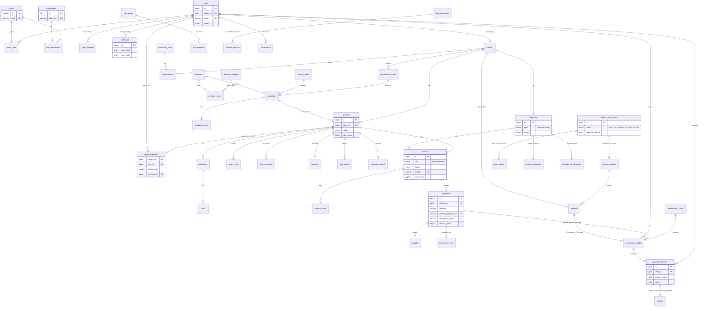

# 03 · Database design

Only the **Foundation** tables exist as migration `0001_foundation.sql` (verified against MariaDB 10.11). Everything else below is the *design* that later phases will migrate, module by module. Column lists show keys and the columns that carry business rules, not every column.

Conventions: InnoDB, utf8mb4, UTC, `BIGINT` money in minor units (+ `currency CHAR(3)`), basis points for rates, `public_id CHAR(32)` for URLs, `created_at/updated_at` everywhere, soft-archive (`status`/`archived_at`) instead of deleting anything financial.

## Entity relationship diagram (target design)

## Integrity rules enforced in schema or transaction (to be covered by tests when built)

| Rule | Mechanism |
|---|---|
| Only Admin assigns projects | `project_members.assigned_by` NOT NULL, service checks `projects.assign`; only Admin holds it (tested in matrix tests) |
| Access to project data limited to assigned users | Every project-scoped query joins `project_members` (or client ownership); one policy class per module; files streamed through a controller only |
| No duplicate client payment | `UNIQUE(gateway, gateway_payment_id)`, `UNIQUE(idempotency_key)`, `UNIQUE(gateway, event_id)` on `payment_events`; payment insert inside a transaction that first does `SELECT … FOR UPDATE` on the invoice and rejects over-payment |
| Payments are immutable | No UPDATE/DELETE path; refunds are new negative rows; invoice balance is **derived** from payments, not stored as a mutable truth |
| Payment only confirmed by gateway | `captured_at` set only from signature-verified webhook/callback handler |
| Freelancer commission from amounts actually received | `commission_ledger` rows are created **by payment capture events** (`payment_id` FK), never from invoice totals |
| Referral 10% / 5% | Two ledger entries per referred project, `trigger` = `ADVANCE_RECEIVED` / `FULL_PAYMENT_RECEIVED`, unique per `(referral_id, trigger)` so they cannot double-pay |
| Rejection requires reason | `CHECK`-equivalent in service + DB `NOT NULL` via status-dependent validation; test per transition |
| Referral emails only after Admin confirm | Emails are rows in `email_outbox` created only by the confirm action (`confirmed_by`, `confirmed_at` NOT NULL) |
| Renewal invoice cannot be payable without approval | `invoices.kind='renewal'` → `ISSUED` transition requires an existing `renewal_approvals` row (service + test) |
| Renewed only with provider confirmation | `RENEWED` transition requires a `provider_confirmations` row (reference, recorded_by) |
| Priority charge reflected in quotation | `quotation_items` includes a `priority_charge` line computed from `priority_levels` at quote time and **snapshotted** (later config edits don't change issued quotes) |
| Invoice numbering | Gap-free per financial year via a `number_sequences` row locked `FOR UPDATE`; format is decision D-07 |
| Financial audit history | `Audit::record()` in the same transaction for every money state change; chain verified by `audit:verify` |

## Foundation tables (built)

`roles`, `permissions`, `role_permissions`, `users`, `user_roles`, `login_attempts`, `audit_logs`, plus the migrator's own `schema_migrations`.
