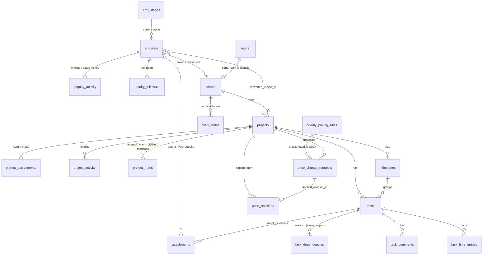
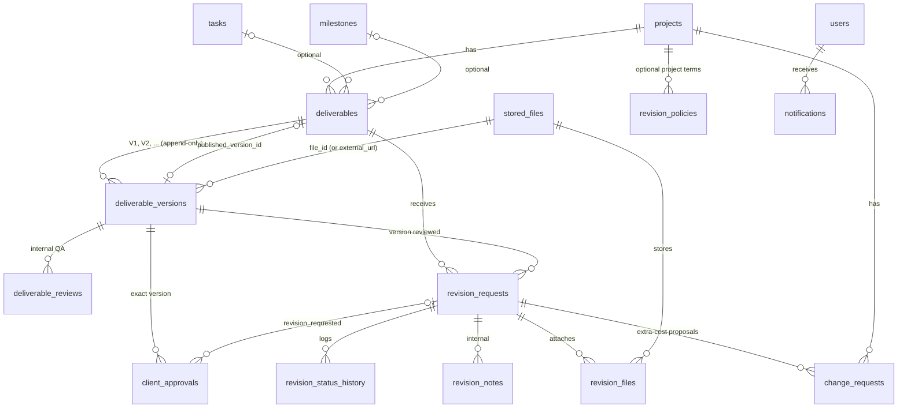
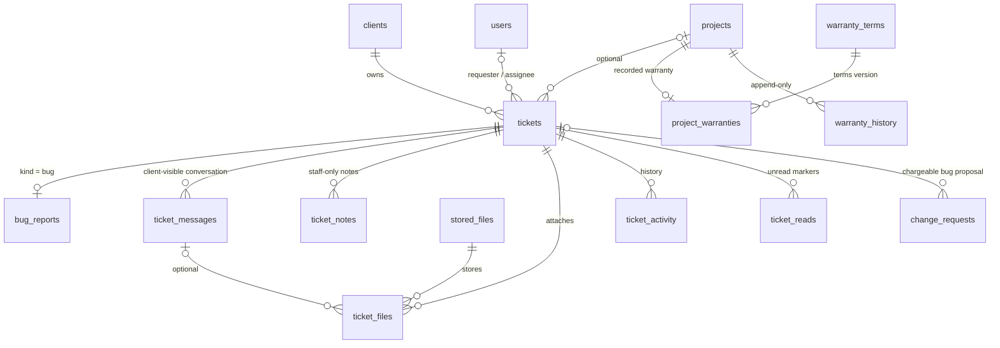
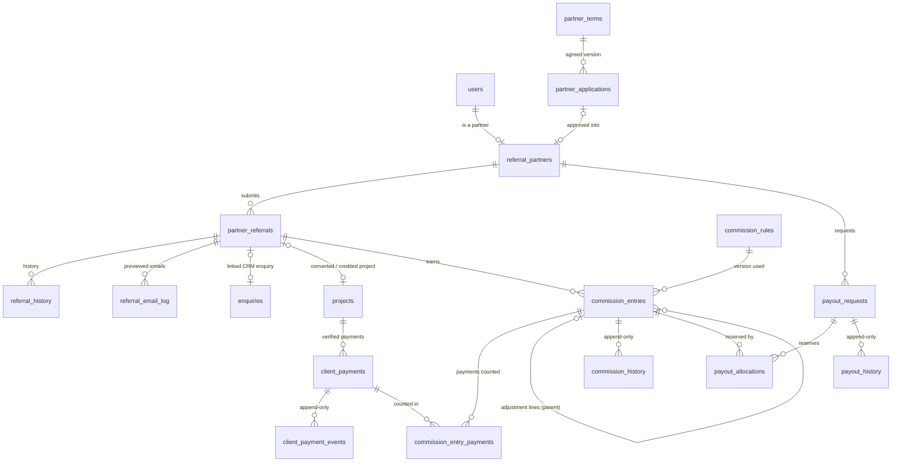
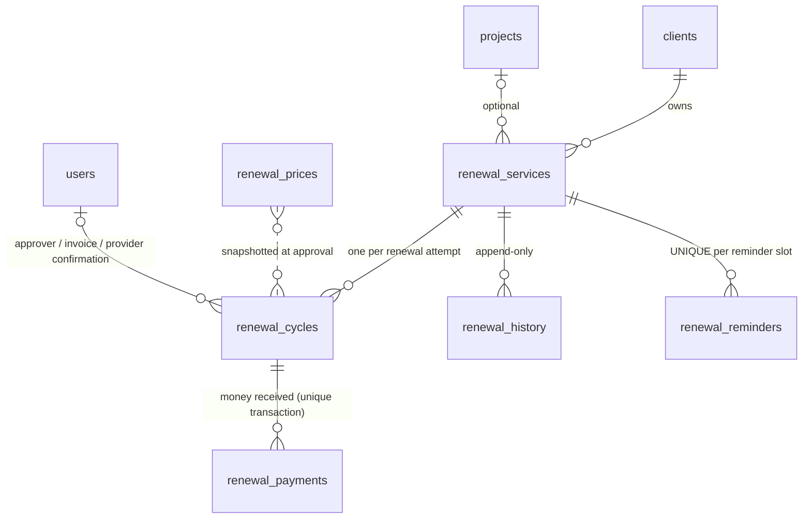

# 03 · Database design

Only the **Foundation** tables exist as migration `0001_foundation.sql` (verified against MariaDB 10.11). Everything else below is the *design* that later phases will migrate, module by module. Column lists show keys and the columns that carry business rules, not every column.

Conventions: InnoDB, utf8mb4, UTC, `BIGINT` money in minor units (+ `currency CHAR(3)`), basis points for rates, `public_id CHAR(32)` for URLs, `created_at/updated_at` everywhere, soft-archive (`status`/`archived_at`) instead of deleting anything financial.

## Entity relationship diagram (target design)

## Integrity rules enforced in schema or transaction (to be covered by tests when built)

| Rule | Mechanism |
|---|---|
| Only Admin assigns projects | `project_members.assigned_by` NOT NULL, service checks `projects.assign`; only Admin holds it (tested in matrix tests) |
| Access to project data limited to assigned users | Every project-scoped query joins `project_members` (or client ownership); one policy class per module; files streamed through a controller only |
| No duplicate client payment | `UNIQUE(gateway, gateway_payment_id)`, `UNIQUE(idempotency_key)`, `UNIQUE(gateway, event_id)` on `payment_events`; payment insert inside a transaction that first does `SELECT … FOR UPDATE` on the invoice and rejects over-payment |
| Payments are immutable | No UPDATE/DELETE path; refunds are new negative rows; invoice balance is **derived** from payments, not stored as a mutable truth |
| Payment only confirmed by gateway | `captured_at` set only from signature-verified webhook/callback handler |
| Freelancer commission from amounts actually received | `commission_ledger` rows are created **by payment capture events** (`payment_id` FK), never from invoice totals |
| Referral 10% / 5% | Two ledger entries per referred project, `trigger` = `ADVANCE_RECEIVED` / `FULL_PAYMENT_RECEIVED`, unique per `(referral_id, trigger)` so they cannot double-pay |
| Rejection requires reason | `CHECK`-equivalent in service + DB `NOT NULL` via status-dependent validation; test per transition |
| Referral emails only after Admin confirm | Emails are rows in `email_outbox` created only by the confirm action (`confirmed_by`, `confirmed_at` NOT NULL) |
| Renewal invoice cannot be payable without approval | `invoices.kind='renewal'` → `ISSUED` transition requires an existing `renewal_approvals` row (service + test) |
| Renewed only with provider confirmation | `RENEWED` transition requires a `provider_confirmations` row (reference, recorded_by) |
| Priority charge reflected in quotation | `quotation_items` includes a `priority_charge` line computed from `priority_levels` at quote time and **snapshotted** (later config edits don't change issued quotes) |
| Invoice numbering | Gap-free per financial year via a `number_sequences` row locked `FOR UPDATE`; format is decision D-07 |
| Financial audit history | `Audit::record()` in the same transaction for every money state change; chain verified by `audit:verify` |

## Foundation tables (built)

`roles`, `permissions`, `role_permissions`, `users`, `user_roles`, `login_attempts`, `audit_logs`, plus the migrator's own `schema_migrations`.

## Phase 2 tables (BUILT: migrations 0005–0007)

Integrity rules: the FKs from pricing/financial and history tables (`price_revisions`, `price_change_requests`, `project_activity`, `milestones`, `tasks`, notes, comments, time entries) to `projects`/`clients` are `RESTRICT`, so deleting a project can never cascade through financial history (the app never deletes projects; it archives). Non-financial exceptions: Phase 1 `project_assignments` cascades, `enquiries.converted_project_id` is `SET NULL`; `task_dependencies` has `CHECK (task_id <> depends_on_task_id)` and the service rejects cycles under a project row lock; unique keys on `enquiries.reference`, `projects.code`, `public_id` columns, `(project_id, revision_no)`, one *current* pricing rule per (service, priority) via a nullable `current_flag`; money is `BIGINT` paise, rates are basis points; everything is archived (`archived_at`) rather than deleted; `price_revisions` is append-only (no code path updates or deletes it, enforced by a source-scanning test).

## Phase 3 tables (BUILT: migration 0008)

Rules: every foreign key above is `RESTRICT` (or `SET NULL` for optional user/task/milestone links); `deliverable_versions` has `UNIQUE (deliverable_id, version_no)` and `CHECK (file_id IS NOT NULL OR external_url IS NOT NULL)`; one current policy per scope via `current_flag`; `UNIQUE (user_id, dedupe_key)` on notifications and `UNIQUE (user_id, submit_token)` on client approvals/`(requested_by, submit_token)` on revisions make retries idempotent; stored paths are unique random strings.

## Phase 5: support tickets and warranty (migration 0009)

Rules: every foreign key is `RESTRICT` (or `SET NULL` for optional user links; `ticket_reads.user_id` cascades with the user); `UNIQUE (requester_id, submit_token)` and `UNIQUE (author_id, submit_token)` make retried form posts idempotent; one warranty row per project (`UNIQUE project_id`); one current terms version (`current_flag`); warranty status is not stored, it is derived from the recorded dates and today's date; `ticket_notes` and `ticket_messages` are different tables so no conversation query can return an internal note.

## Phase 6: referral partners, commissions, payouts (migration 0010)

Integrity rules in the schema: `UNIQUE partner_applications.active_key` (one open application per email), `UNIQUE (partner_id, submit_token)` on referrals and payouts (double submit), `UNIQUE partner_referrals.credit_project_id` (one credited referral per project), `UNIQUE client_payments.external_key` (a transaction reference is recorded once), `UNIQUE commission_entries (referral_id, milestone, seq)`, `UNIQUE payout_requests.payment_reference`, `UNIQUE referral_email_log.sent_key` (set only on a successful send), `UNIQUE commission_rules.current_flag` (one current version). Money is `BIGINT` paise. Foreign keys are `RESTRICT` (or `SET NULL` for optional user/CRM links); history tables are append-only by convention and by the absence of any update/delete code path.

## Phase 7: domain / hosting / SSL renewals and the scheduler (migration 0011)

`renewal_services` UNIQUE (client_id, service_type, identifier); `renewal_cycles` UNIQUE (service_id, cycle_no) and holds the approved price snapshot, the quotation/invoice references, `paid_minor`, and the provider confirmation (`provider_confirmation_ref`, `provider_confirmed_by/at`, `new_expiry`); `renewal_payments.payment_key` is UNIQUE (SHA-256 of method and reference) so a transaction cannot be counted twice; `renewal_reminders` UNIQUE (service_id, expires_on, kind, offset_days, audience, channel) is the claim that makes reminders idempotent; `renewal_prices` is append-only with UNIQUE (service_type, period_months, effective_from); `scheduler_runs` records every run of `schedule:run`. There is **no column for a provider password or credential** and a test asserts it. Foreign keys are `RESTRICT` (or `SET NULL` for optional user/project links). Money is `BIGINT` paise.

