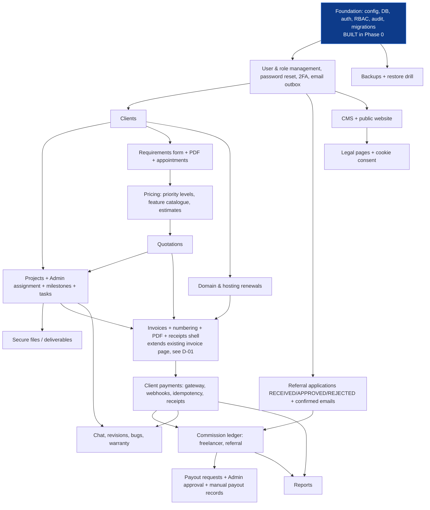

# 05 · Module dependency map and phased implementation plan

## Dependency map

An arrow means "cannot be built/finished before". Solid foundation modules are built; everything else is planned.

Critical path: **Foundation → Users → Clients → Projects → Pricing/Quotes → Invoices → Payments → Commissions → Payouts**. Referrals, support, renewals and CMS branch off it and can be reordered.

## Phased plan (each phase ends with: working feature, tests, docs, and a stop for review)

| Phase | Scope | Done when |
|---|---|---|
| **0** (this) | Inspection, architecture, foundation | Lint, 68 PHPUnit tests, migration + HTTP smoke tests pass |
| **1** | Admin user/role management UI; invite + password reset (email via outbox); TOTP 2FA for Admin/Manager; admin shell navigation; account settings | An Admin can onboard every role type; reset flow tested; audit entries for each action |
| **2** | Clients, projects, **Admin-only assignment**, milestones (create/propose/approve per permission), tasks, secure file upload/download with project-membership policy | A non-assigned user provably cannot read a project or file (policy tests incl. IDOR attempts) |
| **3** | Priority levels (configurable), feature catalogue, estimator, quotations with snapshotted priority charge line | Quote totals reproducible; config change does not alter issued quotes |
| **4** | `Money` service; invoices (project kind), gap-free numbering, PDF, **integration/extension of existing invoice page** once D-01 resolved | Invoice math tested to the paisa; PDFs generated |
| **5** | Gateway integration (provider per D-05), signature-verified webhooks, idempotency, reconciliation view, receipts | Duplicate/replayed webhooks cannot create a second payment; sandbox end-to-end run |
| **6** | Commission rules + ledger, freelancer commission on received amounts, payout requests, Admin approval, manual payout records; referral applications, partners, 10%/5% commissions, confirmed emails | Ledger entries only from captured payments; double-payout impossible by constraint |
| **7** | Chat, revisions, bug reports, 6-month warranty; requirements form → PDF; appointment booking | Warranty window computed from the agreed trigger (D-10) |
| **8** | Renewals (approval + provider confirmation gates); CMS; public site; legal pages; cookie consent | Renewal cannot be payable/Renewed without the required records |
| **9** | Reports, backups + restore test, performance, security review, launch checklist | Restore drill succeeded; pen-test checklist clean |

Rules for every phase: no UI control without working backend; no fake payment states; migrations forward-only; permission matrix test updated with each new permission.
